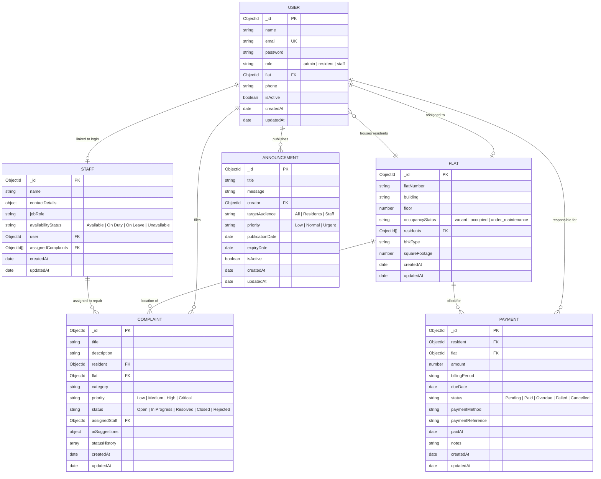

# Database Design & Schemas

## Database Architecture
The backend uses **MongoDB** managed through **Mongoose ODM**. The schema design balances relational consistency with document flexibility, enforcing strict validation, indexing, and data security.

---

## Entity Relationship Diagram

---

## Data Dictionary

### 1. `User` Collection
Stores authentication credentials, contact information, and role assignments.

| Field | Type | Constraints | Description |
| :--- | :--- | :--- | :--- |
| `_id` | `ObjectId` | Primary Key, Auto-generated | Unique identifier |
| `name` | `String` | Required, Max: 100 chars, Trim | Full name |
| `email` | `String` | Required, Unique, Lowercase, Trim, Regex | Validated user email |
| `password` | `String` | Required, Min: 6 chars, `select: false` | Bcrypt salted hash (cost: 10) |
| `role` | `String` | Enum: `admin`, `resident`, `staff`, Default: `resident` | Role-based permission tier |
| `flat` | `ObjectId` | Ref: `Flat`, Default: `null` | Associated flat unit for residents |
| `phone` | `String` | Trim, Optional | Mobile contact number |
| `isActive` | `Boolean` | Default: `true` | Account active state |
| `createdAt` | `Date` | Mongoose timestamp | Registration date |
| `updatedAt` | `Date` | Mongoose timestamp | Last profile update date |

---

### 2. `Flat` Collection
Represents individual apartment units inside buildings/blocks.

| Field | Type | Constraints | Description |
| :--- | :--- | :--- | :--- |
| `_id` | `ObjectId` | Primary Key, Auto-generated | Unique identifier |
| `flatNumber` | `String` | Required, Trim, Max: 20 chars | Apartment unit identifier (e.g. "101") |
| `building` | `String` | Required, Trim, Max: 50 chars | Block/Tower name (e.g. "Tower A") |
| `floor` | `Number` | Required, Integer | Floor level |
| `occupancyStatus` | `String` | Enum: `vacant`, `occupied`, `under_maintenance`, Default: `vacant` | Current occupancy |
| `residents` | `[ObjectId]`| Ref: `User` | Array of resident IDs living in flat |
| `bhkType` | `String` | Enum: `1BHK`, `2BHK`, `3BHK`, `4BHK`, `Penthouse`, `Studio`, `Other` | Floor plan category |
| `squareFootage` | `Number` | Default: `0` | Size in sq ft |
| **Index** | Compound | `{ building: 1, flatNumber: 1 }` (**Unique**) | Prevents duplicate flat records |

---

### 3. `Complaint` Collection
Manages resident maintenance requests, priority escalation, staff assignments, and AI recommendations.

| Field | Type | Constraints | Description |
| :--- | :--- | :--- | :--- |
| `_id` | `ObjectId` | Primary Key, Auto-generated | Unique identifier |
| `title` | `String` | Required, Trim, Max: 150 chars | Summary of issue |
| `description` | `String` | Required, Trim, Max: 2000 chars | Detailed problem description |
| `resident` | `ObjectId` | Required, Ref: `User` | Resident who submitted request |
| `flat` | `ObjectId` | Required, Ref: `Flat` | Physical unit where issue occurs |
| `category` | `String` | Enum: `Plumbing`, `Electrical`, `Carpentry`, `HVAC`, `Security`, `Sanitation`, `Civil/Structural`, `General`, `Other` | Maintenance category |
| `priority` | `String` | Enum: `Low`, `Medium`, `High`, `Critical`, Default: `Medium` | Urgency level |
| `status` | `String` | Enum: `Open`, `In Progress`, `Resolved`, `Closed`, `Rejected`, Default: `Open` | Lifecycle state |
| `assignedStaff` | `ObjectId` | Ref: `Staff`, Default: `null` | Technician assigned to job |
| `aiSuggestions` | `Object` | Embedded object | `{ category, priority, suggestedAction, confidenceScore, generatedAt }` |
| `statusHistory` | `Array` | Embedded objects | Audit trail: `[{ status, updatedBy, note, updatedAt }]` |

---

### 4. `Payment` Collection
Maintains maintenance fee schedules and records of payments received.

| Field | Type | Constraints | Description |
| :--- | :--- | :--- | :--- |
| `_id` | `ObjectId` | Primary Key, Auto-generated | Unique identifier |
| `resident` | `ObjectId` | Required, Ref: `User` | Resident responsible for payment |
| `flat` | `ObjectId` | Required, Ref: `Flat` | Flat unit associated with dues |
| `amount` | `Number` | Required, Min: `0` | Maintenance charge in local currency |
| `billingPeriod` | `String` | Required, Trim | Month/Year (e.g. "October 2026") |
| `dueDate` | `Date` | Required | Payment deadline date |
| `status` | `String` | Enum: `Pending`, `Paid`, `Overdue`, `Failed`, `Cancelled`, Default: `Pending` | Payment state |
| `paymentMethod` | `String` | Enum: `Cash`, `Bank Transfer`, `UPI`, `Cheque`, `Credit Card`, `Debit Card`, `Other`, Default: `null` | Receipt method |
| `paymentReference`| `String` | Trim, Default: `null` | Bank reference / transaction identifier |
| `paidAt` | `Date` | Default: `null` | Timestamp when payment was verified |
| `notes` | `String` | Trim, Optional | Accounting notes |

---

### 5. `Staff` Collection
Tracks facility management technicians, contact details, and their active jobs.

| Field | Type | Constraints | Description |
| :--- | :--- | :--- | :--- |
| `_id` | `ObjectId` | Primary Key, Auto-generated | Unique identifier |
| `name` | `String` | Required, Trim, Max: 100 chars | Technician full name |
| `contactDetails` | `Object` | `{ email: String, phone: String (Required) }` | Contact coordinates |
| `jobRole` | `String` | Enum: `Plumbing`, `Electrical`, `Carpentry`, `HVAC`, `Cleaner`, `Security Guard`, `Maintenance Supervisor`, `Other` | Specialization |
| `availabilityStatus`| `String` | Enum: `Available`, `On Duty`, `On Leave`, `Unavailable`, Default: `Available` | Availability |
| `user` | `ObjectId` | Ref: `User`, Optional | Login account link if technician has portal access |
| `assignedComplaints`| `[ObjectId]` | Ref: `Complaint` | Linked active complaints |

---

### 6. `Announcement` Collection
Maintains society broadcast announcements and notices.

| Field | Type | Constraints | Description |
| :--- | :--- | :--- | :--- |
| `_id` | `ObjectId` | Primary Key, Auto-generated | Unique identifier |
| `title` | `String` | Required, Trim, Max: 150 chars | Headline |
| `message` | `String` | Required, Trim, Max: 3000 chars | Full text announcement |
| `creator` | `ObjectId` | Required, Ref: `User` | Admin user who posted notice |
| `targetAudience` | `String` | Enum: `All`, `Residents`, `Staff`, Default: `All` | Target group |
| `priority` | `String` | Enum: `Low`, `Normal`, `Urgent`, Default: `Normal` | Visual alert tier |
| `publicationDate`| `Date` | Default: `Date.now` | Publish timestamp |
| `expiryDate` | `Date` | Optional | Auto-expiry cutoff date |
| `isActive` | `Boolean` | Default: `true` | Visibility flag |
